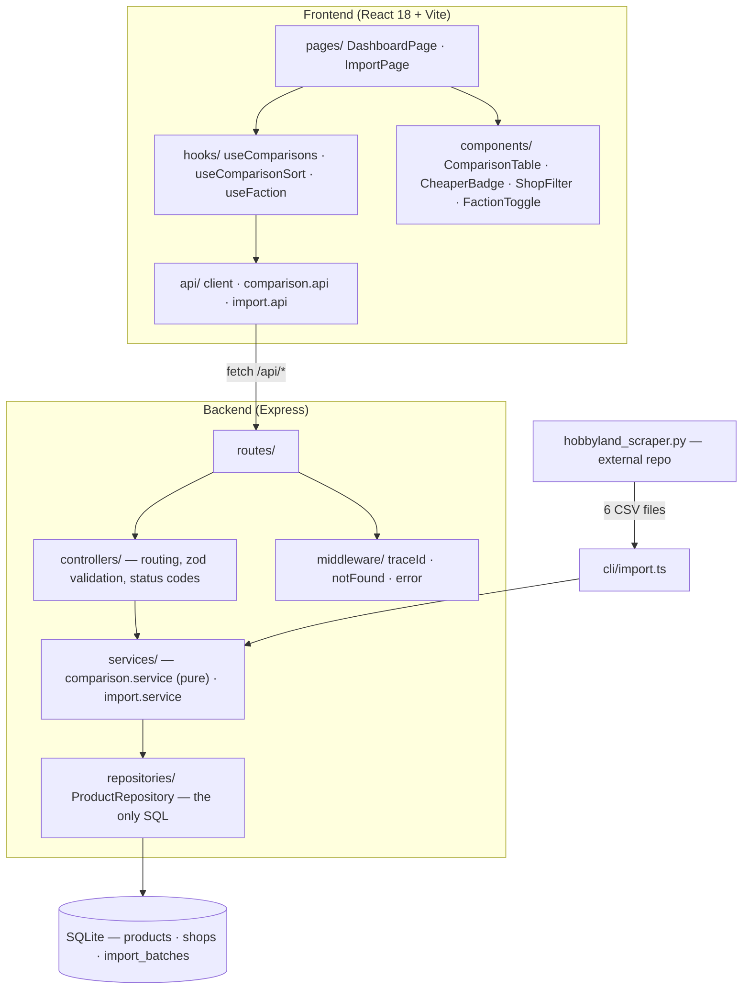
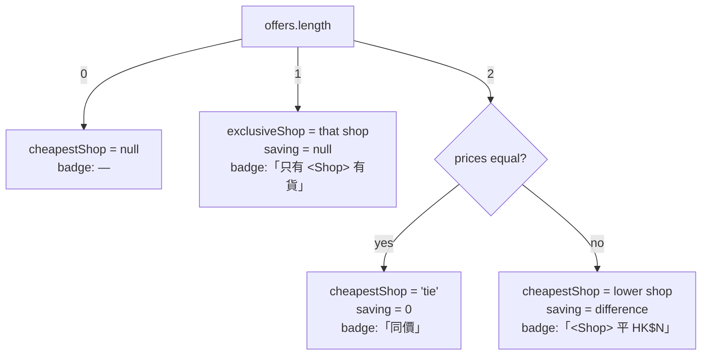
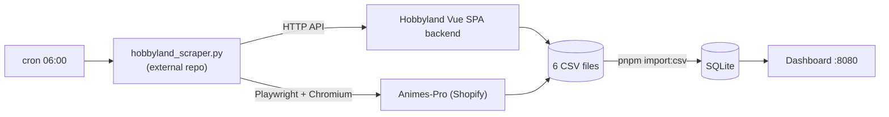

# Gunpla Price Comparison Dashboard

A self-hosted dashboard that answers one question: **for a given Bandai Gunpla kit, which of the two
Hong Kong hobby shops is cheaper — and does only one of them actually stock it?**

It ingests scraper output from [Hobbyland E-Shop](https://www.hobbylandeshop.com) and
[Animes-Pro](https://animes-pro.com), matches listings across the two shops by JAN barcode, and
renders a per-SKU verdict.

```
682 products · 481 comparison groups · HG 280 / MG 170 / RG 31   (as of 2026-10-11)
```

---

## 1. Purpose

Both shops sell overlapping Bandai catalogue, but they price independently, run different
promotions, and — critically — **carry different subsets of the catalogue**. Of the 481 matched
`(grade, sku)` groups, only 201 are sold by both shops; **280 are exclusive to one**.

That distribution drives the central design constraint: a naive "cheapest shop" badge is wrong more
often than it is right, because a lone offer cannot win a price comparison. Saying「Animes 平」
("Animes is cheaper") for a kit Hobbyland does not even list is not a rounding error, it is a
different claim. The verdict model is therefore explicit about which of the two situations it is in
(see [§4.2](#42-the-verdict-contract)).

Secondary goals:

- **Zero infrastructure.** Embedded SQLite, no database server, no queue, no cloud dependency.
  One container, one bind-mounted volume.
- **Auditable imports.** Every CSV load leaves an append-only batch record; re-imports are
  idempotent.
- **Re-runnable data pipeline.** Scrape → CSV → import is a single cron-able command.

---

## 2. What it does

| Area | Behaviour |
|---|---|
| **Comparison grid** | One row per `(grade, sku)`, both shops' prices side by side, sale vs. regular price, stock / pre-order note, product thumbnail |
| **Verdict badge** | 「<Shop> 平 HK$N」when both sell it and prices differ, 「同價」when equal, 「只有 <Shop> 有貨」when only one carries it |
| **Frozen, sortable header** | Column header stays pinned while the grid scrolls; 產品 and both price columns sort asc/desc |
| **Shop filter** | 有售舖頭 select narrows to the SKUs a given shop carries (default 全部) |
| **Grade tabs + search** | HG / MG / RG switch and a title-or-SKU search, both server-side |
| **CSV import** | Upload through the「匯入」page, or bulk-import a folder via CLI |
| **Theme** | Dark HUD cockpit skin, switchable between 聯邦 (Federation) and 自護 (Zeon) palettes; the choice persists across reloads |

---

## 3. Technology

### Runtime

| Layer | Choice | Why |
|---|---|---|
| Language | TypeScript 5.7, `strict` + `noUncheckedIndexedAccess` + `exactOptionalPropertyTypes` | The last two are what catch the `undefined`-vs-missing-key class of bug in DTO construction |
| Runtime | Node.js ≥ 22.13 | `node:sqlite` is a builtin — no native module to compile, no better-sqlite3 rebuild pain |
| Package manager | pnpm 11 (workspace: `backend`, `frontend`) | Single lockfile, per-package scripts |

### Backend

| Dependency | Version | Role |
|---|---|---|
| `express` | 4.21.2 | HTTP + static SPA serving |
| `node:sqlite` | builtin | `DatabaseSync`, WAL mode |
| `zod` | 3.24.1 | Query-param and env validation at the boundary |
| `csv-parse` | 5.6.0 | CSV parsing (`bom: true`, `columns: true`) |
| `multer` | 2.0.1 | Multipart upload, memory storage, 10 MB cap |
| `pino` | 9.6.0 | Structured JSON logs |
| `tsx` / `vitest` / `supertest` | dev | Watch mode, unit + API-level tests |

No ORM. SQL is hand-written and confined to `ProductRepository`. The schema in
`backend/drizzle/0000_init.sql` is `CREATE TABLE IF NOT EXISTS` DDL executed on every boot, plus one
in-place guard that adds `image_url` to databases created before that column existed — so an
existing `data/hobbyland.db` upgrades itself rather than failing.

### Frontend

| Dependency | Version | Role |
|---|---|---|
| `react` / `react-dom` | 18.3.1 | Function components + hooks only |
| `@tanstack/react-query` | 5.62.11 | Server state, caching, refetch-on-filter |
| `vite` | 6.0.7 | Dev server (`/api` proxied to :8080) + production build |
| `@testing-library/react` / `jsdom` / `vitest` | dev | Component and hook tests |

Local UI state stays in `useState`; only server data goes through React Query. No global store —
the app has exactly two pages and one shared preference (the faction theme).

---

## 4. Design

### 4.1 Layering

Strict one-way layering; skipping a layer is not done anywhere in the codebase.



- Controllers never see SQL; the repository never sees HTTP types.
- `comparison.service.buildComparisons()` is a **pure function** (`ProductRow[] → ComparisonRow[]`),
  which is why it is trivially unit-testable without a database.
- The CLI and the upload controller share the same `import.service` — one import path, two entry
  points.

### 4.2 The verdict contract

This is the one design decision worth reading before touching the comparison logic.

```ts
ComparisonRow = {
  sku, grade, title,
  offers: Offer[],                       // sorted by price ascending
  cheapestShop: 'hobbyland' | 'animes-pro' | 'tie' | null,
  saving: number | null,                 // null when only one shop carries the SKU
  exclusiveShop: 'hobbyland' | 'animes-pro' | null,   // set iff offers.length === 1
}
```

`cheapestShop` and `exclusiveShop` answer **different questions**, and both are needed:

- `cheapestShop` → *"who would win a `?cheaper=` filter?"*
- `exclusiveShop` → *"was there a race at all?"*



The single-shop branch **also** sets `cheapestShop` to that shop. That is deliberate: it keeps
`?cheaper=<shop>` matching exclusive listings, preserving the existing API contract. The UI must
branch on `exclusiveShop` *first* — `CheaperBadge` does exactly that.

The rejected alternative was letting the badge infer exclusivity from `saving === null`. It works
until someone adds a case where saving is legitimately null, and then it fails silently and
invisibly. Making the state a named field costs one line in the service and removes the coupling.

### 4.3 Data model

```
shops(id, code UNIQUE, name)                        -- seeded: hobbyland, animes-pro
import_batches(id, source_file, shop_code, grade,
               row_count, skipped_count, imported_at)
products(id, shop_id FK, sku, grade, title, price,
         regular_price, url, stock, sell_type,
         image_url, batch_id FK, imported_at,
         UNIQUE (shop_id, sku, grade))              -- the upsert key
```

- **Identity is the 13-digit JAN barcode** (`sku`), extracted from the product title for Animes-Pro
  and supplied directly by Hobbyland's API.
- The group key is `(grade, sku)`, **not** `sku` alone: the same JAN appearing in both an HG and an
  MG listing stays two separate comparison rows, because they are different kits at different price
  points.
- Indexes on `sku` and `grade` back the comparison query.
- Rows without a JAN (e.g. non-Gunpla figures in Animes-Pro's MG collection) are skipped at import —
  they can never match across shops, so storing them would only add noise. 103 of 246 rows in
  `animes-pro_mg.csv` fall into this category.

### 4.4 Import semantics

```
absent → imported (batch N) → re-imported (batch N+1): price / url / stock overwritten
```

`import_batches` is append-only; it is an audit trail, not a cache. One file = one batch = one
transaction, so a failure mid-file rolls back completely with no partial rows and no batch record.

**One field is exempt from overwrite:**

```sql
image_url = COALESCE(excluded.image_url, products.image_url)
```

The importer sweeps *every* matching CSV in its directory, but the scraper may only have regenerated
some of them. A CSV that predates the `image_url` column parses that field as `null`, so a plain
overwrite would null out thumbnails that are already on file — a partial scrape of one grade
silently wiped a whole grade's images. `COALESCE` makes re-import non-destructive for images while
leaving price and stock to refresh normally.

A shop delisting a product does **not** delete the row; the last known price persists.

### 4.5 Frontend state boundaries

| Concern | Owner | Transport |
|---|---|---|
| Grade, search text | `DashboardPage` | **Server-side** (`?grade=`, `?q=`) — refetches |
| Shop filter, column sort | `DashboardPage` / `useComparisonSort` | **Client-side** — no extra round trip |
| Faction theme | `useFaction` | `localStorage` → `<html data-faction>` |

One `GET /api/comparisons?grade=&q=` response (≤ 280 rows) feeds sorting and filtering, so those
interactions are instant and never re-hit the network.

A shop that does not carry a SKU has no price to rank, so it **always sorts last in both
directions** — flipping a descending sort should not suddenly pile all the "not sold here" cells at
the top.

### 4.6 Theme

A single global faction theme, switched in the header:

| Faction | Accent | Highlight |
|---|---|---|
| 聯邦 Federation | `#58a6e8` | `#f0c343` |
| 自護 Zeon | `#d9483b` | `#e6e1d7` |

Implemented as CSS custom properties scoped to `html[data-faction=…]`. An inline bootstrap in
`index.html` applies the stored value **before first paint** so the accent never flashes the wrong
faction; `useFaction` owns it thereafter.

The two shops are deliberately **not** faction-coloured — they are separated by neutral value only
(`--shop-a` bright, `--shop-b` dim). Painting one shop red and one blue would imply an allegiance
the data does not have; the faction is a skin, not a claim.

Two CSS details that are load-bearing rather than cosmetic:

- `border-collapse: separate; border-spacing: 0` — collapsing borders are unreliable on a
  `position: sticky` cell in some engines, and the header must stay pinned.
- The sticky `th` fill is opaque and its bottom rule is an `inset box-shadow`, or rows scroll
  visibly through the header.

---

## 5. Quickstart

```bash
corepack enable
pnpm install
pnpm build          # type-check + build both packages
pnpm test           # backend 21 + frontend 41
pnpm dev            # backend :8080 (tsx watch) + frontend :5173 (vite, /api proxied)
```

> **The database is not committed.** `data/` is gitignored, so a fresh clone starts empty and the
> dashboard will read「冇資料 — 請先匯入 CSV」until you import (see [§6](#6-data-pipeline)).

Production-style run (backend serves the built SPA):

```bash
pnpm build && pnpm start        # http://localhost:8080
```

---

## 6. Data pipeline



The scraper lives **outside this repository**, at `~/github/python_program/hobbyland_scraper.py`.
It is not vendored here because it has its own dependency profile (a Python `venv` plus Playwright):

- **Hobbyland** is a Vue SPA whose category pages ship an empty HTML shell, so the scraper POSTs to
  the shop's own JSON API (`backend.hobbylandeshop.com/api/products`) and walks `total_pages`.
  Image paths come back relative to the static CDN and are absolutised before writing.
- **Animes-Pro** sits behind Shopify bot protection — collection pages 302 to a
  `__shopify_bv_challenge` URL and `/products.json` hard-429s scripted clients. A real Chromium
  solves the challenge, then listing pages are walked and product cards read from the DOM
  (handling lazy-load `data-src` / `srcset`, protocol-relative `//`, and `{width}` templates).

CSV contract (UTF-8 BOM):

```
title,price,url,regular_price,sku,stock,sell_type,image_url
```

Import:

```bash
pnpm import:csv                                        # every matching CSV in CSV_DIR
pnpm import:csv -- --dir /path/to/csvs                 # explicit folder
pnpm import:csv -- --file /path/to/hobbyland_hg.csv    # single file
```

`CSV_DIR` or `--dir` / `--file` is **required**; with none of them the CLI exits 1 with an
actionable error rather than guessing a location. Filenames must match
`(hobbyland|animes-pro)_(hg|mg|rg).csv` — the shop and grade are taken from the filename.

Scrape-and-import in one step:

```bash
pnpm scrape                                  # host mode, all categories
scripts/scrape-and-import.sh rg hg           # selected categories only
scripts/scrape-and-import.sh --docker        # import into the running container
```

---

## 7. Configuration

| Variable | Default | Purpose |
|---|---|---|
| `PORT` | `8080` | HTTP listen port |
| `DATA_DIR` | `<repo>/data` | SQLite directory (`/data` inside Docker) |
| `NODE_ENV` | `development` | Express mode |
| `CSV_DIR` | *(none)* | Default `--dir` for the import CLI |
| `LOG_LEVEL` | `info` | pino level |

Copy `.env.example` to `.env` and adjust. SQLite is embedded, so there is no connection pool to
tune. `createDatabase()` sets `PRAGMA journal_mode = WAL` (reads continue during an import) and
`PRAGMA foreign_keys = ON`.

---

## 8. API

All responses use one envelope:

```jsonc
// success
{ "code": 0, "message": "ok", "data": <T>, "timestamp": "<ISO-8601>" }
// error — also returned as the x-trace-id response header
{ "code": <httpStatus>, "message": "<reason>", "data": null, "timestamp": "<ISO>", "traceId": "<id>" }
```

| Method | Path | Query / Body | `data` |
|---|---|---|---|
| `GET` | `/api/comparisons` | `grade?=hg\|mg\|rg`, `q?=text`, `cheaper?=hobbyland\|animes-pro` | `ComparisonRow[]` |
| `GET` | `/api/products` | `shop?`, `grade?`, `q?` | `ProductRow[]` |
| `GET` | `/api/imports` | — | latest 20 `ImportBatchDto[]` |
| `POST` | `/api/import` | multipart `file` (CSV) + fields `shop`, `grade` | `{ batchId, rowCount, skipped }` (201) |

Query params are validated with zod; an invalid `grade` is a `400` with field-level messages and a
`traceId`. Uploads: zero valid rows → `422`, malformed CSV → `400`.

Any non-`/api/*` path falls through to `frontend/dist/index.html` when that directory exists, so
the SPA routes work in production.

---

## 9. Docker

```bash
scripts/docker-build.sh              # tags :latest and :<timestamp>
scripts/docker-deploy.sh             # recreate + health-check
scripts/docker-deploy.sh --build     # rebuild the image first
scripts/docker-deploy.sh --import    # also import CSVs inside the container
```

The deploy script is defensive about two failure modes that both occurred in practice:

1. **The daemon is not running** — it detects an unresponsive daemon and starts Docker Desktop /
   OrbStack on macOS (or the `docker` service via `systemctl` on Linux), then waits for readiness.
2. **A stale container holds the port** — it runs `docker compose down --remove-orphans`, then
   removes any leftover container squatting the compose-generated name (a container started outside
   this compose project will not be reclaimed by `down` alone), then `up -d --force-recreate`.
   Without this, an old image keeps serving an outdated API contract on `:8080` and the health check
   passes anyway.

Image: multi-stage `node:24-slim` — stage 1 builds both packages, stage 2 installs backend
production deps only and copies `backend/dist`, `backend/drizzle`, `frontend/dist`. Schema migration
runs on boot and is idempotent.

Volumes: `./data:/data` persists the database; `${CSV_DIR:-./data}:/csvs:ro` exposes CSVs for
in-container import.

---

## 10. Testing

```bash
pnpm test        # backend 21/21 · frontend 41/41
```

| Suite | Environment | Covers |
|---|---|---|
| `comparison.service.test.ts` | node | Verdict computation: cheaper + saving, tie, single-shop, `exclusiveShop`, grade separation, SKU ordering |
| `import.service.test.ts` | node + in-memory SQLite | CSV parsing, validation/skip rules, batch records, upsert idempotency, `image_url` mapping and **preservation** |
| `api.test.ts` | node + supertest | All four endpoints, status codes, `traceId` on validation failure |
| `components.test.tsx` | jsdom + RTL | Badge wording (including that an exclusive SKU never renders「平」), preview image and its error fallback, pre-order flag, tabs, search |
| `sort-filter.test.tsx` | jsdom + RTL | Sort hook (ordering, nulls-last, non-mutation), `aria-sort`, shop filter, filtered counts, filter-specific empty state |
| `faction.test.tsx` | jsdom + RTL | Theme default, persistence across mounts, `<html data-faction>` mirroring, unknown-value fallback |
| `dashboard.test.tsx` | jsdom + RTL | API client unwrapping and `ApiError`, query-string building, refetch on grade change, error surfacing |

The database is a **fresh in-memory SQLite per test** — SQL runs for real rather than being mocked
away. `fetch` is stubbed per test and React Query retries are disabled.

`frontend/tests/setup.ts` installs an in-memory `Storage` shim: Node ≥ 22 exposes an experimental
`localStorage` global that yields `undefined` without `--localstorage-file`, and it shadows the
Storage jsdom would otherwise provide.

Full matrix and manual-verification log: [`docs/TESTING.md`](docs/TESTING.md).

---

## 11. Project layout

```
backend/
  drizzle/0000_init.sql           schema (executed idempotently on boot)
  src/
    index.ts                      bootstrap: config → db → listen
    app.ts                        express wiring + SPA static serving
    config.ts                     zod-validated env
    routes/                       /api router + multer upload
    controllers/                  product · import
    services/                     comparison (pure) · import
    repositories/                 ProductRepository — the only SQL
    middleware/                   traceId · notFound · error
    cli/import.ts                 bulk CSV importer
    utils/                        logger (pino) · AppError
    types/index.ts                DTO contracts
  tests/
frontend/
  index.html                      pre-paint faction bootstrap
  src/
    App.tsx                       shell + page switch + theme owner
    pages/                        DashboardPage · ImportPage
    components/                   ComparisonTable · CheaperBadge · ShopFilter ·
                                  GradeTabs · SearchBar · FactionToggle · FactionCrest
    hooks/                        useComparisons · useComparisonSort · useFaction
    api/                          client · comparison.api · import.api
    types/index.ts                mirrors backend DTOs (+ frontend-only types)
    styles.css                    dark HUD theme, mobile-first
  tests/
scripts/                          docker-build · docker-deploy · scrape-and-import
docs/                             see below
data/                             SQLite (gitignored)
```

---

## 12. Documentation

| Document | Contents |
|---|---|
| [`docs/PROGRAM_SPEC.md`](docs/PROGRAM_SPEC.md) | File map, dependency graph, API contracts, dashboard interaction contract |
| [`docs/FUNCTION_SPEC.md`](docs/FUNCTION_SPEC.md) | Business flow, validation rules, comparison semantics, state transitions, boundary conditions, theme |
| [`docs/ARCHITECTURE.md`](docs/ARCHITECTURE.md) | Mermaid: request sequences, class hierarchy, ER diagram, deployment topology |
| [`docs/DEPLOYMENT.md`](docs/DEPLOYMENT.md) | Runtime requirements, env vars, local dev, Docker, cron chaining |
| [`docs/TESTING.md`](docs/TESTING.md) | Unit suites, integration matrix, manual-verification log, known caveats |
| [`AGENT.md`](AGENT.md) | Original project objective and intended flow |

---

## 13. Known limitations

- **`?cheaper=` includes exclusive listings.** The filter matches on `cheapestShop`, which is also
  set for single-shop SKUs — so `cheaper=hobbyland` on HG returns 200 rows, of which only 59 are
  genuine price wins and 141 are "only Hobbyland stocks it". Preserved deliberately to keep the API
  stable when `exclusiveShop` was added. No UI surface currently exposes the filter; if one ever
  does, decide first whether it should exclude `exclusiveShop != null`.
- **Stock does not affect the verdict.** A pre-order (預訂) offer is compared at face value against
  an in-stock offer. It is flagged visually but not ranked differently.
- **Delisted products persist.** A shop removing a listing does not delete the row, so a stale price
  can survive until the next scrape overwrites it. Full-replacement semantics are not implemented.
- **The scraper is external.** Reproducing the pipeline end to end requires the separate
  `hobbyland_scraper.py` plus its Python `venv` and Playwright Chromium install. Both shops'
  selectors and endpoints can break without notice.
- **No CI.** Tests are run locally; nothing enforces them on push.
