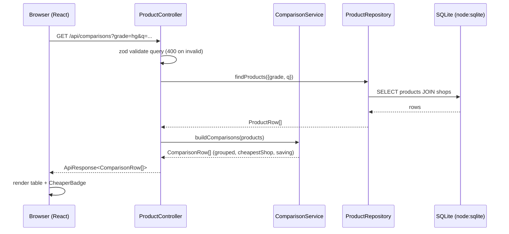
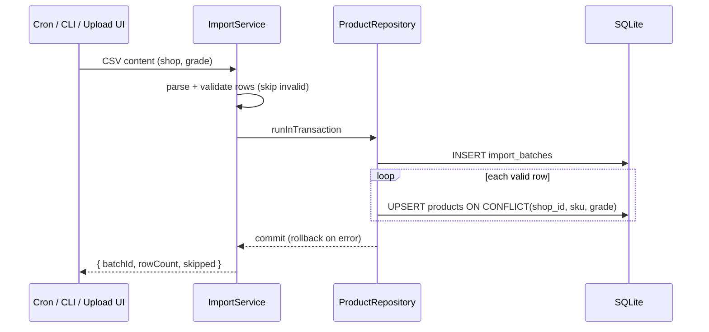
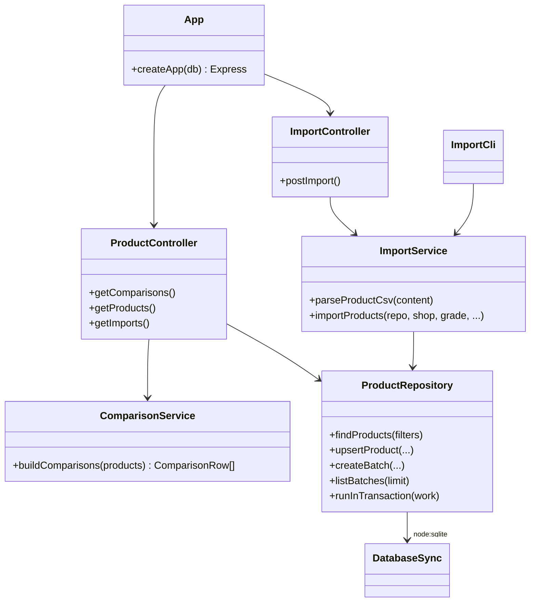
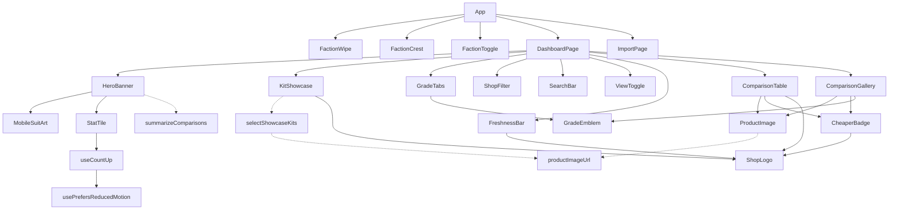
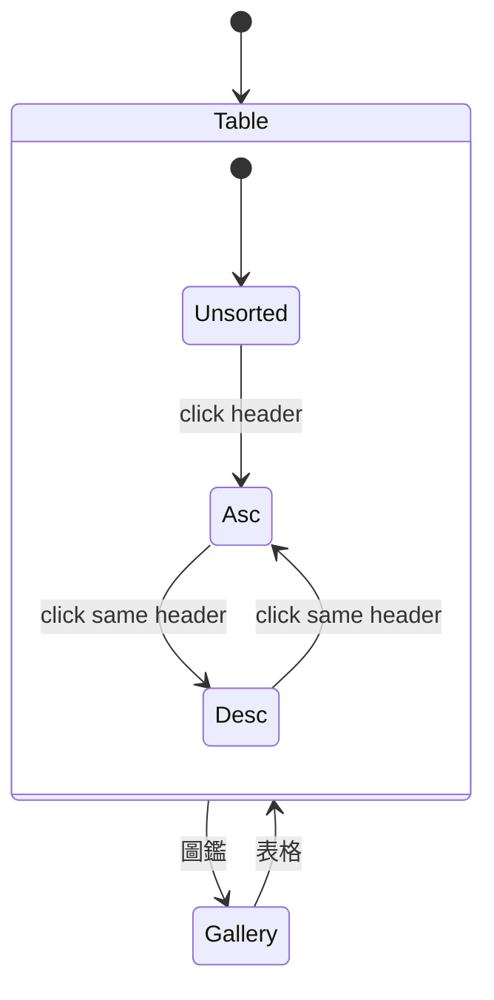
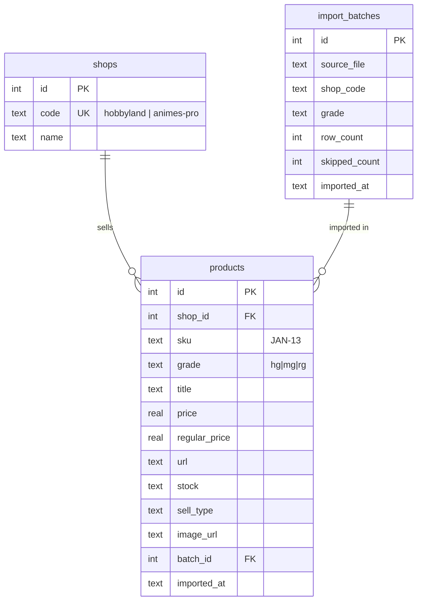
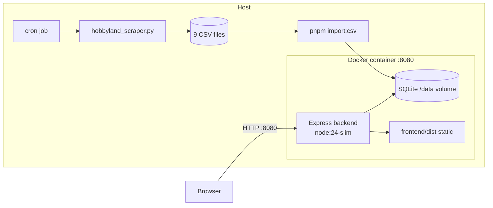

<!-- docs/ARCHITECTURE.md -->
# Architecture & Flow Diagrams

## 1. End-to-End Sequence — Dashboard

## 2. End-to-End Sequence — CSV Import

## 3. Component / Class Hierarchy

### Frontend component hierarchy

### Dashboard view state

## 4. Data Model

`UNIQUE (shop_id, sku, grade)` is the upsert key; indexes on `sku` and `grade` back the
comparison query.

## 5. Deployment Topology

