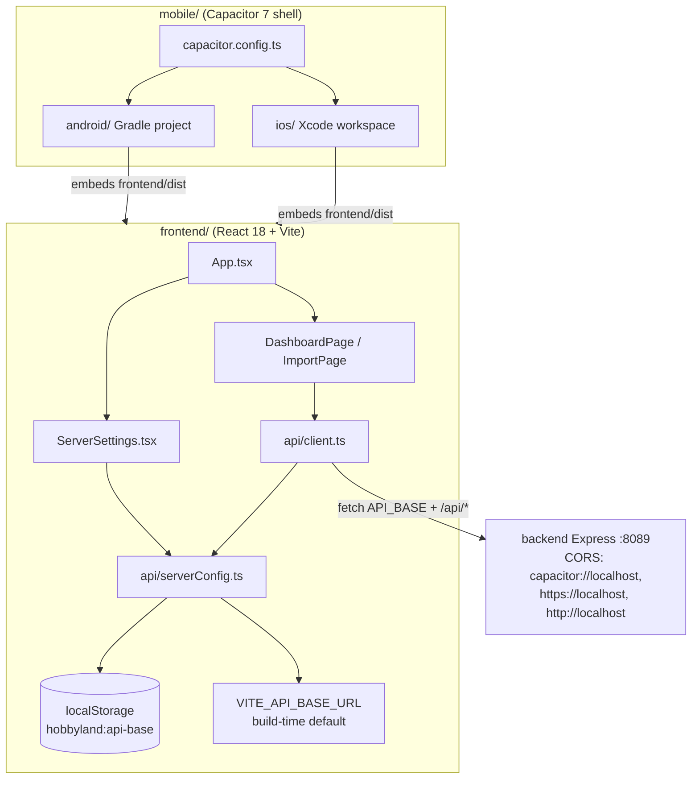
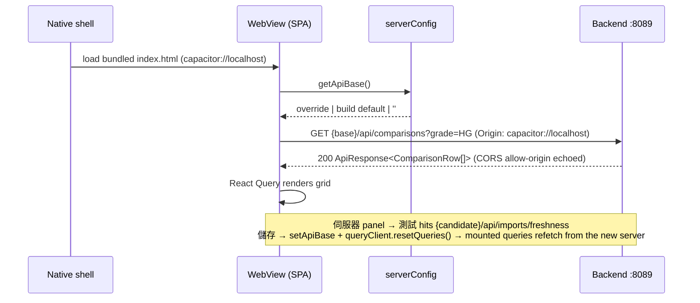

# Mobile App (Android & iOS) — Hybrid WebView Build

The mobile app is a **Capacitor 7 shell** around the existing web frontend: the production
Vite bundle (`frontend/dist`) ships inside the app and is served by the native local WebView
server (`https://localhost` on Android, `capacitor://localhost` on iOS). Only `/api/*` data
calls go over the network to your deployed backend.

```
┌─────────────────────────────┐        ┌──────────────────────────┐
│ Native shell (Capacitor)    │        │ Backend (Express :8089)  │
│  ┌───────────────────────┐  │  HTTP  │  /api/comparisons        │
│  │ WebView               │──┼───────▶│  /api/imports/freshness  │
│  │  frontend/dist (SPA)  │  │  CORS  │  /api/import, /api/scrape│
│  └───────────────────────┘  │        └──────────────────────────┘
└─────────────────────────────┘
```

## Layout of the `mobile/` package

| Path | Purpose |
|---|---|
| `mobile/capacitor.config.ts` | App id (`com.hobbyland.pricecompare`), name, `webDir: ../frontend/dist`, StatusBar/Keyboard plugin config |
| `mobile/android/` | Generated Android project (Gradle). `usesCleartextTraffic=true` so LAN HTTP backends work |
| `mobile/ios/` | Generated iOS project (Xcode workspace, CocoaPods) — created on first `cap add ios` |
| `scripts/build-mobile.sh` | One-shot build: frontend → `cap sync` → APK / IPA into `dist-mobile/` |

## Prerequisites

Common: Node ≥ 22, pnpm (repo root `pnpm install`).

**Android**
- JDK 21+ (`brew install --cask temurin@21`)
- Android SDK (Android Studio, or `sdkmanager` cmdline-tools); `ANDROID_HOME` set or SDK at `~/Library/Android/sdk`

**iOS** (macOS only)
- Xcode 16+ (`sudo xcode-select -s /Applications/Xcode.app`)
- CocoaPods (`brew install cocoapods`)

## Build

```bash
# Both platforms (iOS is skipped automatically off macOS)
API_URL=https://your-host:8089 pnpm mobile:build

# Single platform
API_URL=http://192.168.1.20:8089 pnpm mobile:build:android
API_URL=https://your-host:8089 EXPORT_METHOD=ad-hoc pnpm mobile:build:ios
```

Artifacts land in `dist-mobile/`:
- `hobbyland-android-<stamp>.apk` → signed with the **debug keystore** by default (install with
  `adb install -r <apk>`; fine for sideloading, not publishable to Play Store — set the
  `ANDROID_KEYSTORE*` env vars below for store signing)
- `hobbyland-ios-<stamp>.ipa` → signed when a local Apple identity / `EXPORT_TEAM_ID` is
  available; otherwise an **unsigned** IPA that must be re-signed by the install tool
  (AltStore / Sideloadly) before it can go on a device

Script env knobs: `API_URL` (default first-launch backend, default `http://localhost:8089`),
`ANDROID_KEYSTORE` + `ANDROID_KEYSTORE_PASSWORD` + `ANDROID_KEY_ALIAS`
(+ optional `ANDROID_KEYSTORE_KEY_PASSWORD`) for release APK signing,
`EXPORT_METHOD` (`development` | `ad-hoc` | `app-store` | `enterprise`, default `development`),
`EXPORT_TEAM_ID` (optional Apple developer team id, passed to both archive and export),
`ALLOW_UNSIGNED_IPA=1` (opt in to an unsigned IPA fallback when the signed archive/export fails).

### Run on emulator / simulator during development

```bash
pnpm mobile:sync                 # rebuild web assets + cap sync
pnpm mobile:open:android         # Android Studio → Run
pnpm mobile:open:ios             # Xcode → Run
```

Android emulators reach the host machine at `10.0.2.2`, so build with
`API_URL=http://10.0.2.2:8089` for emulator testing.

## Pointing the app at your deployed backend (no rebuild needed)

`API_URL` only sets the **first-launch default**. The backend address is runtime-configurable:

1. Open the app → header →「伺服器」.
2. Enter the deployment URL, e.g. `https://localhost:8089` (self-hosted on the device itself),
   `http://192.168.1.20:8089` (LAN box) or your public URL. Only scheme + host + port — no path.
3. 測試 verifies connectivity against `/api/imports/freshness`; 儲存 applies it immediately
   (all queries refetch); the choice persists across relaunches (localStorage).
4. 重設預設 restores the baked-in default.

Precedence: in-app override → build-time `VITE_API_BASE_URL` (`API_URL`) → same-origin (web builds).

### HTTPS & certificate caveats

- The backend serves HTTPS only when `certs/` exists (`scripts/generate-cert.sh`), else plain HTTP.
- **Self-signed certificates are silently rejected by the Android WebView** (no trust prompt) and by
  iOS ATS unless exceptions are added. For LAN development use the **HTTP** backend
  (`rm -rf certs` or point `API_URL` at an HTTP listener); for production use a publicly trusted
  certificate (e.g. via reverse proxy / Cloudflare Tunnel).
- Android cleartext HTTP is already permitted in `mobile/android/app/src/main/AndroidManifest.xml`
  (`usesCleartextTraffic="true"`), and `mobile/capacitor.config.ts` sets
  `android.allowMixedContent = true` — the app UI is served from `https://localhost`, so HTTP LAN
  API calls would otherwise be blocked as mixed content. For an HTTP LAN backend on iOS, add an
  ATS exception (`NSAppTransportSecurity` → `NSAllowsLocalNetworking` or a domain exception) in
  `mobile/ios/App/App/Info.plist`.
- The Android debug build trusts the committed public dev certificate
  (`mobile/android/app/src/debug/res/raw/dev_server_cert.pem`, refreshed from `certs/server.pem`
  by `scripts/run-android-emulator.sh`), so self-signed HTTPS works on the emulator without
  disabling checks. The private key (`certs/server-key.pem`) is never committed.

### Backend CORS

The WebView origins differ from the web deployment, so the backend allows them via
`CORS_ORIGINS` (default `capacitor://localhost,https://localhost,http://localhost`). To add a
hosted web origin:

```bash
CORS_ORIGINS="capacitor://localhost,https://localhost,http://localhost,https://your-web-host" node backend/dist/index.js
```

## After changing web code

The app embeds a snapshot of `frontend/dist`. Re-run the build (or `pnpm mobile:sync` + Run from
the IDE) whenever the frontend changes.

## App icons / splash

Capacitor default assets are used for development builds. For store submission, generate branded
assets (e.g. `@capacitor/assets`) from a 1024×1024 icon — out of scope for this iteration.

---

## Program spec (mobile increment)

### Component / dependency graph



### API base resolution precedence

`localStorage(hobbyland:api-base)` → `VITE_API_BASE_URL` (baked by `API_URL=` at build) → `''` (same-origin).
Resolved **per request** in `api/client.ts`, so 儲存 in the panel takes effect without a reload;
on save the React Query cache is **reset** (`resetQueries`) so every mounted query refetches from
the new server. If localStorage persistence fails (privacy mode / quota), the change stays
effective for the rest of the session via an in-memory mirror.

### End-to-end sequence (app launch → data)



### Environment variables

| Variable | Where | Default | Purpose |
|---|---|---|---|
| `API_URL` | `scripts/build-mobile.sh` | `http://localhost:8089` | Baked-in first-launch default backend |
| `VITE_API_BASE_URL` | frontend build | `''` | Same as above (script sets it) |
| `CORS_ORIGINS` | backend runtime | `capacitor://localhost,https://localhost,http://localhost` | Origins allowed cross-origin |
| `ANDROID_KEYSTORE` + `_PASSWORD` + `_ALIAS` (+ `_KEY_PASSWORD`) | `scripts/build-mobile.sh` (Android) | unset | Release keystore signing; unset → debug-keystore-signed APK |
| `EXPORT_METHOD` / `EXPORT_TEAM_ID` | build script (iOS) | `development` / auto | IPA signing (team id reaches both archive and export) |
| `ALLOW_UNSIGNED_IPA` | build script (iOS) | `0` | `1` = allow unsigned-IPA fallback when the signed archive/export fails |

### Test matrix

| ID | Scenario | Preconditions | Input | Expected | Pass criteria |
|---|---|---|---|---|---|
| MOB-01 | Same-origin default | no override, no env | `apiGet('/api/comparisons')` | fetch `'/api/comparisons'` | unit ✅ `client.test.ts` |
| MOB-02 | Build-time default | `VITE_API_BASE_URL=https://build.example` | `getApiBase()` | `https://build.example` | unit ✅ `server-config.test.ts` |
| MOB-03 | Runtime override wins | stored `https://override.example` + env set | `getApiBase()` | override returned | unit ✅ |
| MOB-04 | Invalid URL rejected | — | `setApiBase('not a url')` / `ftp://` / path suffix | throws, nothing persisted | unit ✅ |
| MOB-05 | Settings panel save | app open | 伺服器 → input → 儲存 | localStorage set, cache cleared, refetch | unit ✅ `server-settings.test.tsx` |
| MOB-06 | Connection test | backend reachable | 測試 | `✓ 連線正常` via `/api/imports/freshness` | unit ✅ + manual |
| MOB-07 | CORS preflight | backend running | `OPTIONS /api/comparisons` Origin `capacitor://localhost` | 204 + allow-origin echoed | unit ✅ `cors.test.ts` + curl |
| MOB-08 | Disallowed origin | — | Origin `https://evil.example` | no allow-origin header | unit ✅ |
| MOB-09 | Android APK | JDK 17+, Android SDK | `API_URL=… ./scripts/build-mobile.sh android` | APK in `dist-mobile/` | manual |
| MOB-10 | Android emulator e2e | emulator + backend | install APK, `API_URL=http://10.0.2.2:8089` | dashboard renders live data | manual |
| MOB-11 | iOS IPA | macOS + Xcode + CocoaPods | `./scripts/build-mobile.sh ios` | IPA in `dist-mobile/` | manual |
| MOB-12 | Persistence | MOB-05 done | kill & relaunch app | override still effective | manual |
| MOB-13 | Reset | override stored | 重設預設 | falls back to build default | unit ✅ |
| MOB-14 | Responsive | — | DevTools 375px / 768px / 1024px | no h-overflow, safe-area padding, 44px targets | manual |
| MOB-15 | Session fallback | `localStorage.setItem` throws | 儲存 a new address | new server effective for the session (in-memory mirror), not silently reverted | unit ✅ `server-config.test.ts` |
| MOB-16 | Refetch after save | dashboard mounted | 儲存 a new address | mounted queries refetch from the new server (`resetQueries`, no reload) | unit ✅ `server-settings.test.tsx` |
| MOB-17 | Android APK signing | no `ANDROID_KEYSTORE*` | `./scripts/build-mobile.sh android` | debug-keystore-signed APK, installable via `adb install` | manual |
